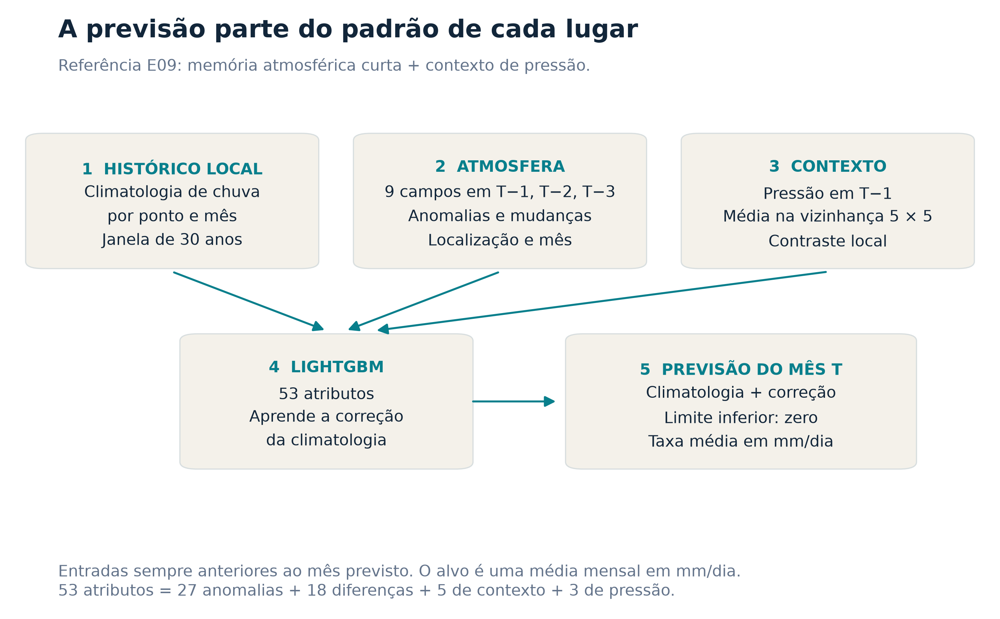
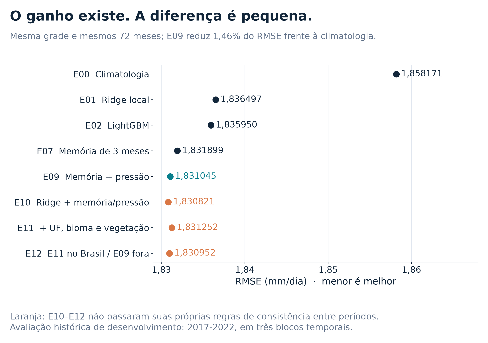
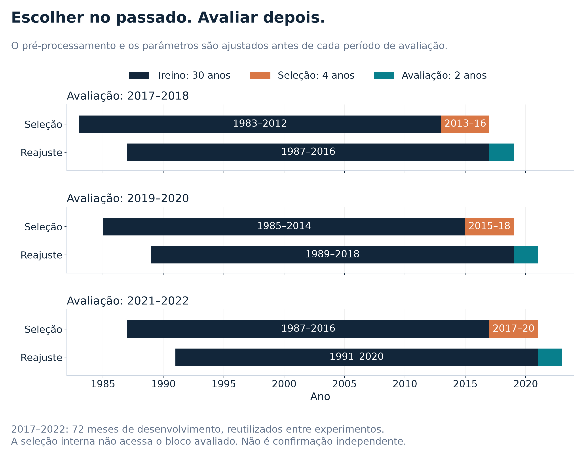
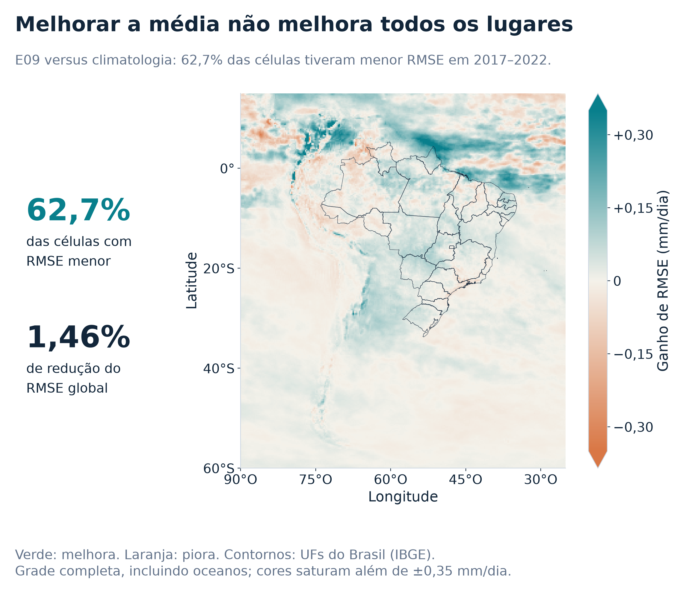
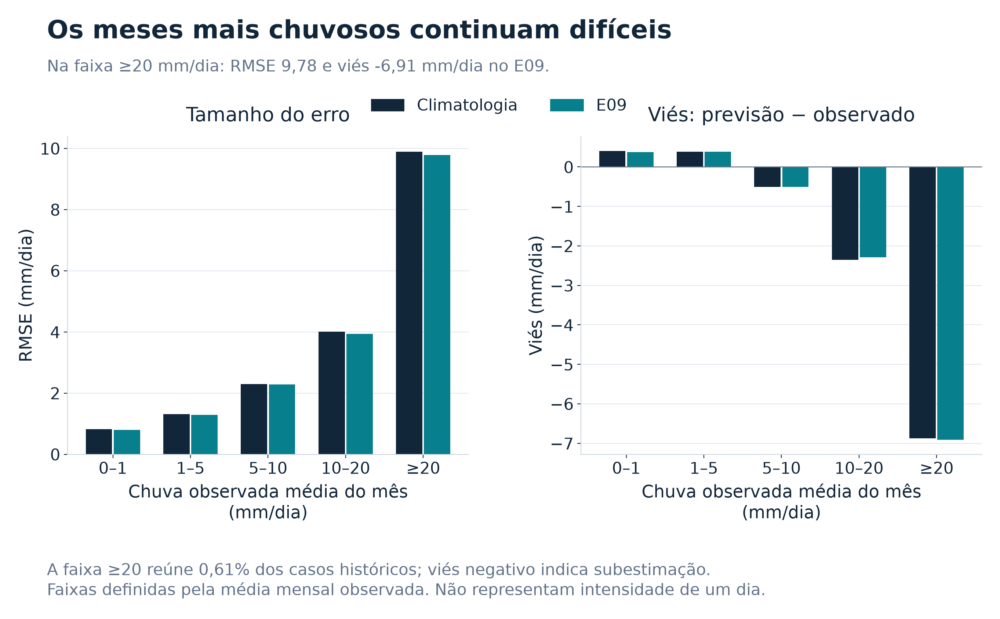
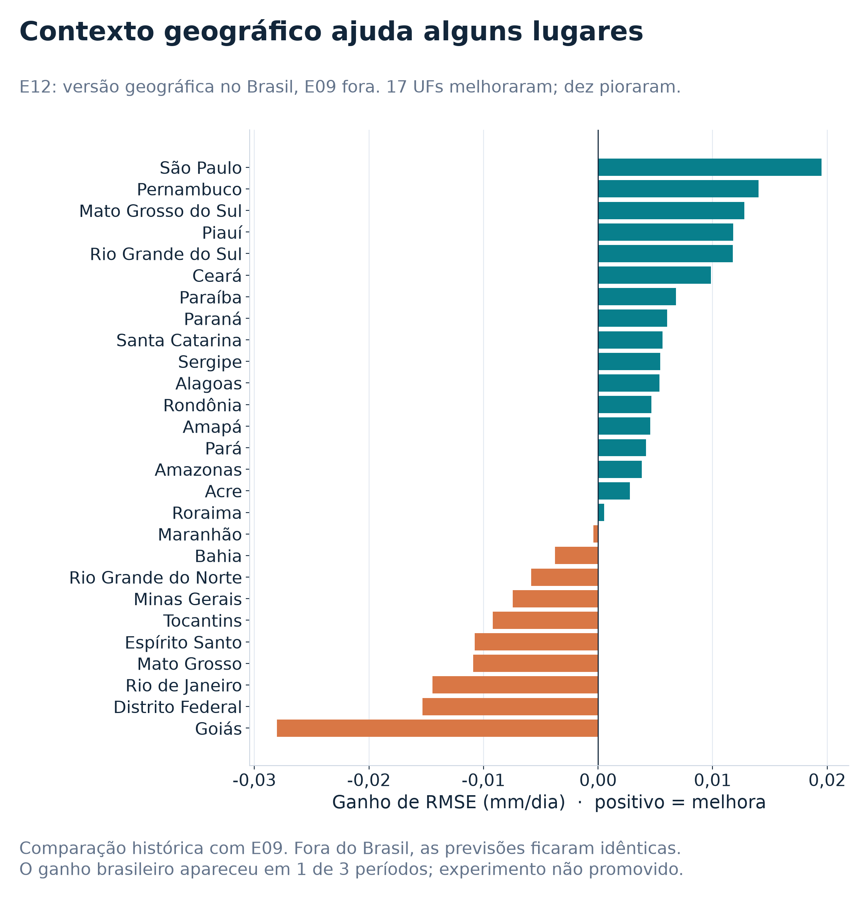

# Previsão mensal de precipitação na América do Sul

Projeto do hackathon **WorCAP 2026 / INPE**: prever a precipitação média do próximo mês a partir das condições atmosféricas anteriores, comparando climatologia, Ridge, LightGBM e hipóteses de especialização regional.

**Modelo principal:** climatologia local + correção LightGBM, com três meses de memória atmosférica e contexto de pressão.



## Resultados

Avaliação histórica em **72 meses (2017-2022)**, com três blocos temporais e seleção de parâmetros no passado:

| Modelo | RMSE (mm/dia) |
|---|---:|
| Climatologia de 30 anos | 1,858171 |
| Ridge local | 1,836497 |
| LightGBM inicial | 1,835950 |
| LightGBM com memória de três meses | 1,831899 |
| **Memória + contexto de pressão (E09)** | **1,831045** |

Redução de **1,46%** frente à climatologia. A grade inclui oceano e tem o mesmo peso por célula. Os blocos foram reutilizados no desenvolvimento: estes resultados não são uma confirmação independente nem medem o erro de 2023-2024.



A combinação E10 teve menor erro agregado exploratório, mas não passou seu critério de consistência entre períodos. O especialista treinado só no Brasil (E13) piorou nos três blocos brasileiros. Mantivemos E09. Detalhes, decisões e limitações: [resultados e método](docs/RESULTADOS.md).

## O que estamos prevendo?

- **Alvo:** taxa média de precipitação de um mês, em mm/dia. Não é a previsão de cada dia.
- **Grade:** 301 × 261 = 78.561 células, resolução de 0,25°.
- **Dados de treinamento:** 1940-2022; cada ajuste usa uma janela de 30 anos.
- **Previsões finais:** janeiro/2023 a dezembro/2024, totalizando 1.885.464 valores.
- Cada mês usa a atmosfera do mês anterior fornecida no teste; não é uma única previsão emitida com 24 meses de antecedência.

### A arquitetura

O LightGBM aprende a diferença entre a chuva observada e a climatologia de cada ponto/mês. São **53 atributos**: 27 anomalias atmosféricas de três meses, 18 diferenças entre meses, cinco atributos de contexto e três de pressão. A previsão final soma a correção à climatologia e limita valores negativos em zero.

Temperatura, umidade, cobertura de nuvens, ventos, pressão e geopotencial entram como campos mensais. As unidades físicas dos preditores não foram certificadas no pacote recebido; o contexto numérico de pressão não demonstra um efeito causal de relevo.



## Executar

Requisitos: **Python 3.12**, [uv](https://docs.astral.sh/uv/getting-started/installation/) e os dados oficiais.
Execute os comandos na raiz do repositório:

```bash
git clone https://github.com/zigfreud/latam-worcap26.git
cd latam-worcap26
uv sync --locked --python 3.12
uv run python -m pytest -q
```

Os **49 testes** usam dados sintéticos e cobrem alinhamento temporal, métricas, memória, contexto espacial, roteamento regional, hashes e recarga do modelo. Não precisam dos dados da competição.

### Treinar a versão final

Obtenha os arquivos na [página de dados do desafio](https://www.kaggle.com/competitions/previsao-climatica-de-precipitacao-sobre-a-america-do-sul/data) e coloque-os em `data/raw/`. Veja a [lista de arquivos](data/README.md).

```bash
uv run python scripts/train_final_model.py --output outputs/E14_reproduzido
```

O diretório de saída deve ser novo. O processo:

1. Confere hashes das entradas contra a auditoria versionada.
2. Usa os 2.500 pontos congelados da grade (900.000 exemplos no ajuste de 30 anos).
3. Treina em 1989-2018 e escolhe 100 ou 300 árvores em 2019-2022.
4. Reajusta em 1993-2022 e prevê os 24 meses.
5. Salva modelo, pré-processamento, histórico atmosférico mínimo, receita e CSV.
6. Recarrega os artefatos e verifica a reprodução exata das previsões.

A execução de referência escolheu **100 árvores**. O erro de seleção interna não é uma nova avaliação independente. O [protocolo do ajuste](docs/ENTREGA_FINAL_PROTOCOLO.md) documenta o procedimento.

### Repetir apenas a inferência

Depois de treinar, use o modelo salvo e os dois arquivos de teste:

```bash
uv run python scripts/predict_final_model.py --model-dir outputs/E14_reproduzido --test data/raw/teste_features.nc --sample data/raw/sample_submission.csv --output outputs/previsao_repetida.csv
```

A inferência não lê a chuva histórica. Ela completa as defasagens de janeiro/fevereiro com outubro/novembro de 2022, salvos junto ao modelo. Entradas e artefatos são validados por SHA-256.

CSV de referência: **1.885.464 linhas**, colunas `id,tp_mm_day`, IDs na ordem do arquivo original, valores finitos e não negativos. SHA-256:

```text
6043f690f78ed2ce1993d05a2895eaa217b959858e803836fa7bc9ce05bb4071
```

O hash corresponde à execução de referência com as versões travadas. Plataformas e versões numéricas diferentes podem produzir diferenças; a recarga verifica o resultado da própria execução.

## Onde melhora e onde falha



**62,7% das células** apresentaram menor RMSE frente à climatologia nesta avaliação. Isso não é a porcentagem de previsões corretas: cada célula agrega 72 meses de erro.



Na faixa de média mensal ≥20 mm/dia, o RMSE ainda é 9,776669 e o viés é -6,912580 mm/dia. Os meses muito chuvosos continuam subestimados.



## Estrutura e materiais

```text
src/worcap/          Modelos, transformações, validação e inferência
tests/               Testes com dados sintéticos
configs/             Receita do modelo principal
scripts/             Ajuste final e inferência
docs/                Método, resultados e protocolo
assets/              Seis gráficos e carrossel do projeto
results/             Tabelas agregadas para inspecionar os gráficos
data/README.md       Origem e preparação dos dados
outputs/             Auditoria de hashes e amostra congelada; resultados locais ignorados
```

[Carrossel do projeto em PDF](assets/WorCAP_2026_Carrossel_LinkedIn.pdf) · [Resultados em tabela](results/comparacao_modelos.csv)

Os arquivos brutos da competição, os modelos e as previsões completas são gerados ou obtidos localmente. O repositório publica código, configuração, testes, amostra de índices, hashes e resultados agregados.

## Créditos e licença

- Desafio: [WorCAP 2026 / INPE](https://www.gov.br/inpe/pt-br/eventos/worcap-2026/hackathon).
- Dados: pacote ERA5 distribuído pela organização no Kaggle; os mapas regionais dos diagnósticos usam fontes IBGE.
- Codex/ChatGPT apoiaram programação, investigação e documentação. As previsões numéricas são produzidas pelos modelos ajustados aos dados.
- Código próprio sob [licença MIT](LICENSE). Dados e bibliotecas mantêm os termos de suas fontes.
